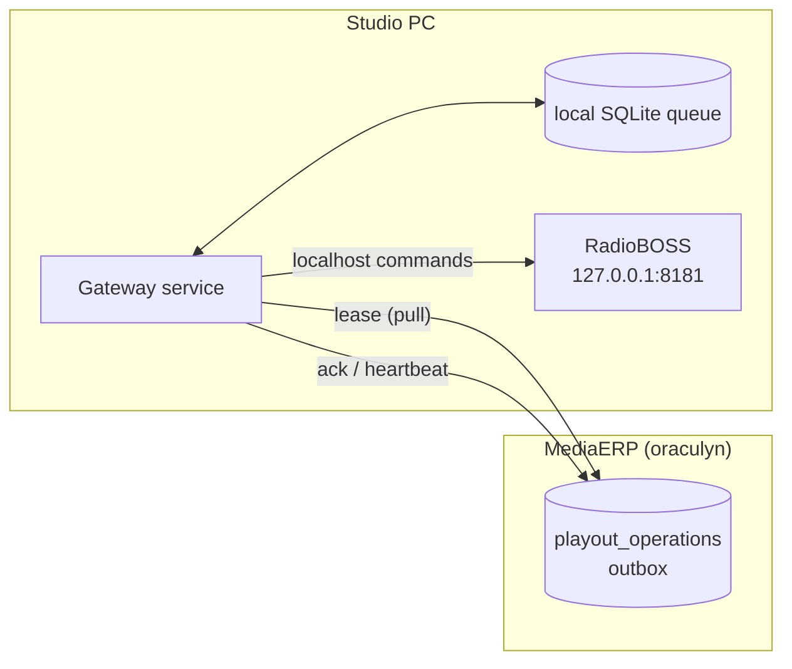
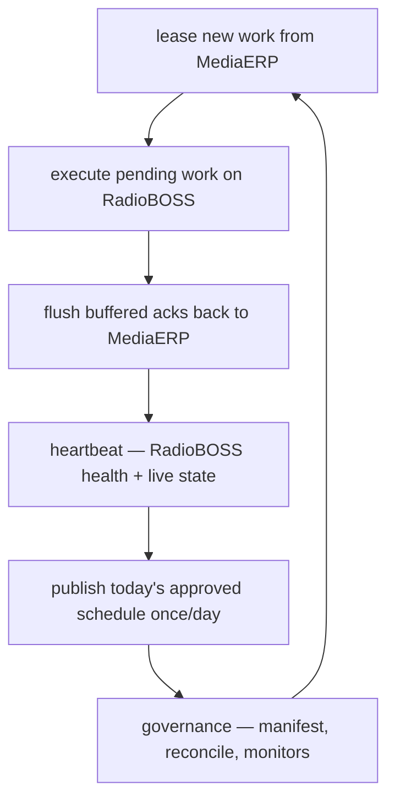

# MediaCore Studio Gateway — How It Works

A reference for what the gateway is, the problem it solves, and how every moving
part fits together. For the step-by-step production switch-over, see
[`CUTOVER.md`](CUTOVER.md).

---

## 1. What it is (in one paragraph)

The Studio Gateway is a small, studio-resident agent (Python, native Windows)
that **pulls** playout commands from MediaERP (the "oraculyn" server), applies
them to **RadioBOSS over `localhost`**, confirms each landed in the playlist,
and reports the outcome back. Because it only ever makes **outbound HTTPS**
calls and talks to RadioBOSS on `127.0.0.1`, RadioBOSS never needs a public IP,
and playout keeps running through an internet outage.

It ships as **two executables**:

| Executable | Role | Visible? |
|---|---|---|
| `mediacore-gateway.exe` | The **service** — does the actual work (delivery + governance). Runs under WinSW as a Windows service. | Headless (no window) |
| `mediacore-gateway-console.exe` | The **operator console** — a read-only dashboard over the live gateway state. | Desktop app (OraMedia UI) |

The console **observes**; it never controls playout. That separation is
deliberate: the service is the compliance-enforcement point and runs under a
locked-down account the operator can't stop or edit.

---

## 2. Why it exists

"Direct" delivery has MediaERP reach across the network into each studio's
RadioBOSS. That requires every RadioBOSS to be reachable from the server, and a
dropped uplink silences the station.

The gateway inverts the flow:



- Only **outbound HTTPS** leaves the studio — no inbound ports, no exposed RadioBOSS.
- The **retry / backoff / DEAD / as-run brain stays server-side.** The gateway is
  the "hands": it applies commands and reports honestly. The server decides what
  to do about failures.
- Leased work and un-posted acks are **persisted locally**, so a lost uplink never
  stops the studio — it keeps airing and syncs up when the link returns.

---

## 3. The tick loop

The service runs one loop, once every `poll_interval` seconds. Each tick, in an
order chosen for offline resilience (`gateway/worker.py`):



1. **Lease** — claim a batch of due commands. If the uplink is down, this is
   skipped silently and the loop continues from the local queue.
2. **Execute** — apply each queued command to RadioBOSS (runs regardless of the
   uplink).
3. **Flush acks** — post buffered outcomes back. Retried until the uplink returns.
4. **Heartbeat** — report health + live playback on its own cadence; also the
   low-latency channel for **urgent** cut/switch commands (they ride the
   heartbeat response and are queued like any other work).
5. **Publish** — once a day, fetch the approved schedule and write a local `.m3u`
   backstop (see §7).
6. **Governance** — sync the approved-content manifest, reconcile the live
   playlist, poll host monitors, report violations (see §8).

A bad tick is caught and logged — it never kills the daemon.

---

## 4. Authentication & delivery mode

The gateway authenticates with a **per-station key**, not a user login (a machine
can't carry a UserCore JWT).

- Every request sends `X-Gateway-Key: <the station's gateway_key>`.
- The server looks up `Station::where('gateway_key', $key)`:
  - no match → **401 "Invalid gateway key"**
  - match but `delivery_mode <> 'gateway'` → **403 "not in gateway delivery mode"**
- So a station is "gateway-enabled" by setting two columns on `media_stations`:

  | Column | Value |
  |---|---|
  | `gateway_key` | a strong unique key, also placed in the gateway's `.env` |
  | `delivery_mode` | `gateway` (default is `direct`) |

Moving a station to `gateway` mode is the cutover: the server stops calling
RadioBOSS directly and instead **enqueues** commands into `playout_operations`
for the gateway to pull. Do it one station at a time (see `CUTOVER.md`).

---

## 5. The MediaERP contract

All under the API base (`GATEWAY_ERP_BASE_URL`, e.g.
`https://mediacore.oraculyn.com/api/v1`). The `/v1` is required.

| Method & path | Purpose |
|---|---|
| `POST /gateway/lease` | Claim due commands → `{station_id, lease_ttl, operations:[…]}` |
| `POST /gateway/ack` | Report outcomes → drives the server's retry/DEAD logic |
| `POST /gateway/heartbeat` | Report alive + live playout → may return `{urgent:[…]}` |
| `GET  /gateway/files/{asset_id}` | Download a creative's bytes (+ `X-Checksum`) |
| `GET  /gateway/schedule?date=YYYY-MM-DD` | The approved day's playlist |
| `GET  /gateway/manifest` | Approved-content manifest + governance policy |
| `POST /gateway/violations` | Report compliance violations detected on-site |
| `POST /gateway/interactions` | Register inbound listener SMS as audience reach |

A leased **operation** looks like:

```json
{ "command_id": "…", "command_type": "inserttrack",
  "payload": { "file": "…", "title": "…", "asset_id": 12, "checksum": "…" },
  "priority": 0, "attempts": 0, "spot_booking_id": 45 }
```

---

## 6. Executing & confirming commands

`gateway/executor.py` maps a command to RadioBOSS and produces an ack result.

**Command types** (vendor-neutral, mirror the RadioBOSS Remote API):

| `command_type` | RadioBOSS action |
|---|---|
| `inserttrack` | insert a file at a position (default `-2` = after current) |
| `delete` | remove playlist positions |
| `setnexttrack` | set the next track |
| `setcasttitle` | set the streaming title |
| `command` | transport control — `next` / `stop` / `play N` |

**"Confirm properly" for `inserttrack`.** An OK response isn't enough — the file
must actually be in the playlist. The executor:

1. Ensures the creative is **staged locally** (see §7); airs the local path, never
   a server path.
2. Counts how many copies of the creative are in the playlist, inserts, then
   confirms the count **rose by one** (a count delta). This is correct even when
   the same ad legitimately airs more than once.
3. On a genuine **re-attempt** of the same `command_id` (a prior try crashed
   before it was recorded), if the item is already present it's confirmed
   **without re-inserting** — no double-air.

The `confirmed` flag in the ack is what the server uses to mark a spot
`SCHEDULED`. Idempotency is also enforced at the queue: a command already
executed and awaiting ack is never re-queued.

---

## 7. Offline resilience (the local queue) + file sync

**Local queue** (`gateway/queue.py`, SQLite WAL, `data/gateway.db`):

- `work` — leased commands not yet executed.
- `acks` — executed outcomes awaiting a successful post back.

Everything is keyed by `command_id`, so a re-lease is idempotent. A poison
command (one that keeps failing) is **dead-lettered** after
`GATEWAY_MAX_EXECUTE_ATTEMPTS` tries so it can't block the queue forever.

**File sync (Phase 3, `gateway/filesync.py`).** RadioBOSS plays files by disk
path, so a creative must exist locally before it can air. FileSync:

- checks the local copy by **SHA-256**, downloads from `/gateway/files/{id}` only
  if missing/changed, verifies integrity against the expected checksum, then
  atomically renames into place;
- downloads run on a **background thread pool** and **stream** to disk — a slow or
  large download never stalls the hot playout path or the urgent-command channel.

**Schedule publication (Phase 4, `gateway/publisher.py`).** Once a day the gateway
pulls the approved schedule, syncs every creative locally, and writes a
`YYYY-MM-DD.m3u` with **local paths**. That file is the resilience backstop: a
full day of approved content can air even if the uplink is down all day.

---

## 8. Governance & compliance (Phase 6)

The gateway is the on-site enforcement point for "only approved content on air."

**Approved manifest** (`gateway/manifest.py`) — synced from `/gateway/manifest`,
it's the source of truth for what's allowed: each approved asset keyed by
**checksum** and by **filename basename**, plus the governance **policy**
(allowed folders, USB block, app allowlist, `auto_cut`, switch command).

**Classifier** (`gateway/classifier.py`) — separates approved from unapproved by
**identity, not audio**: it matches each playlist track against the manifest by
basename, and by SHA-256 when the file is on disk. Anything not in the manifest
is "unapproved." (Audio fingerprinting is explicitly out of scope.)

**Reconciler** (`gateway/reconciler.py`) — reads the live playlist and flags every
unapproved item, carrying its position so the worker can act.

**Enforcement** (`gateway/worker.py::_governance`):

- If policy `auto_cut` is on, unapproved **queued** items are deleted. A `next`
  (skip) is sent **only when the track currently on air is itself unapproved** —
  so an approved track that happens to be playing is never cut.
- Host monitors (best-effort, no-op without their libs): **USB storage**
  detect/block, **rogue-app** detection, **folder** lockdown.
- Findings are reported to `/gateway/violations`.

**Violation de-duplication (server-side).** The gateway re-reports the same
on-air unapproved content each cycle. The server **upserts** by content identity
instead of inserting duplicates:

- **new** content → one `playout_violations` row **+ one alert**;
- an **already-open** violation for the same content → the existing row is
  updated: `seen_count++`, `last_seen_at = now` (no duplicate row, no repeat
  alert).

So the Compliance screen shows one line per distinct violation ("seen N times,
last at …"), and `resolved_at` closes it out.

---

## 8.5 Listener engagement (inbound SMS → presenter + reach)

A studio-local feature ported from the legacy RadiQ app: listeners text the
station, and the gateway turns those SMS into two things — a **live feed the
presenter reads on-air** and **registered audience reach** in MediaERP.

**Ingest** (`gateway/sms.py`, `GATEWAY_SMS_SOURCE`):
- `http` (recommended) — an off-the-shelf Android SMS-forwarding app (SMSSync,
  "SMS to URL Forwarder", android-sms-gateway webhook, Tasker, …) is configured
  to **POST each incoming SMS** to the gateway. The gateway **listens** on
  `GATEWAY_SMS_HTTP_BIND` (host:port, default `0.0.0.0:8099`); the phone pushes
  over the LAN (or via `adb reverse` for USB-only). An optional
  `GATEWAY_SMS_HTTP_TOKEN` authenticates the phone. The receiver is tolerant of
  the many field names apps use (`from`/`sender`/`phone`, `message`/`text`/`body`, …).
- `adb` — a phone over USB/Bluetooth read via a **bundled `adb.exe`**
  (`content://sms/inbox`). Works only where the shell user may read SMS
  (older/permissive Android); the `http` app model is the robust modern path.

> Alternative (backlog): a branded **OraMedia SMS Relay** app instead of an
> off-the-shelf forwarder — tracked in [`TODO-android-sms-app.md`](TODO-android-sms-app.md).
> No gateway changes needed; it targets the same HTTP receiver contract.

Each new message is buffered in the local `listener_messages` table (dedup by
`(source, external_id)`), then POSTed to `/gateway/interactions`. Buffering
means an uplink outage never loses a message — it's registered when the link
returns, same as acks.

**Reach** (server side): each sender upserts a `media_listeners` row (phone →
name, first/last seen, count) and logs a `media_listener_interactions` row tied
to the station (and program, when known). De-duplicated by `(source,
external_id)`, so a re-post never double-counts. **Reach = distinct listeners.**

The console's **Listener Messages** tab shows the feed (sender, message, time,
✓ = registered) for the presenter.

## 9. The operator console

`console/` is a PyQt6 desktop app (OraMedia-branded) that mirrors the legacy
RadiQ layout but is backed by **live gateway data**, read-only:

- **Previous / Current / Next track** + clock — from RadioBOSS `playbackinfo`.
- **Running Order** — the live RadioBOSS playlist.
- **Gateway Health** — service state, RadioBOSS reachability, uplink, queue
  depth, buffered acks.
- **Log** — tails `data/gateway.log` (multi-line records folded into one row).
- **Operations** — recent `leased / executed / acked / auto-cut` activity.
- **Schedule** — today's approved playlist + a manifest/policy summary.
- **Listener Messages** — inbound listener SMS for the presenter to read on-air.
- **Listen** — monitor the public broadcast stream (`GATEWAY_MONITOR_STREAM_URL`).

It reads the same `data/gateway.db` and `data/gateway.log` the service writes,
plus RadioBOSS on localhost. It sends nothing to RadioBOSS, so it can't affect
playout — the compliance model holds.

> Note: the console infers **Uplink** from the service log. A genuinely working
> uplink that has nothing to do (0 leased ops) is quiet, so the indicator leans
> on periodic positive signals (e.g. `manifest synced`). If it lags reality,
> it's cosmetic — the authoritative check is a 200 from `/gateway/lease`.

---

## 10. Configuration (`.env`, `GATEWAY_*`)

Loaded by `gateway/config.py` (pydantic-settings). Found next to the `.exe`
first, then the working dir. Keys:

| Key | Default | Meaning |
|---|---|---|
| `GATEWAY_ERP_BASE_URL` | — | MediaERP API base, **including `/v1`** |
| `GATEWAY_GATEWAY_KEY` | — | this station's key (matches `media_stations.gateway_key`) |
| `GATEWAY_GATEWAY_ID` | `gw-1` | stable id for this gateway (shows as `leased_by`) |
| `GATEWAY_LEASE_LIMIT` | `50` | max commands per lease |
| `GATEWAY_POLL_INTERVAL` | `5` | tick interval (s) |
| `GATEWAY_HEARTBEAT_INTERVAL` | `5` | heartbeat cadence (s) |
| `GATEWAY_HTTP_TIMEOUT` | `10` | ERP request timeout (s) |
| `GATEWAY_RADIOBOSS_BASE_URL` | `http://127.0.0.1:9000` | localhost RadioBOSS API |
| `GATEWAY_RADIOBOSS_USER` / `_PASSWORD` | — | RadioBOSS Remote API creds |
| `GATEWAY_INSERT_POSITION` | `-2` | insert position (`-1` end, `-2` after current, `-3` after scheduled) |
| `GATEWAY_MEDIA_FOLDER` | `media` | where synced creatives land |
| `GATEWAY_SCHEDULE_FOLDER` | `data/schedule` | where the daily `.m3u` is written |
| `GATEWAY_DOWNLOAD_WORKERS` | `2` | concurrent background downloads |
| `GATEWAY_MAX_EXECUTE_ATTEMPTS` | `5` | tries before a command is dead-lettered |
| `GATEWAY_MONITOR_STREAM_URL` | — | public stream the console can "Listen" to |
| `GATEWAY_SMS_SOURCE` | — | listener SMS ingest: `adb` \| `gsm` \| blank (off) |
| `GATEWAY_SMS_ADB_DEVICE` / `_GSM_PORT` | — | phone serial / modem COM port |
| `GATEWAY_DB_PATH` | `data/gateway.db` | local queue DB |
| `GATEWAY_LOG_LEVEL` | `INFO` | log verbosity |

The MediaERP URL is **baked into the installer** for safety, so the operator
never types it — a gateway can only ever talk to the official server.

---

## 11. Installation & the Windows service

- Ships as a single **Setup.exe** (Inno Setup). The wizard collects the station
  key, RadioBOSS creds, and folders, writes a locked-down `.env`, installs the
  **WinSW** service, and starts it.
- **Upgrade-aware**: a stable `AppId` + a registry version marker let the
  installer detect an existing install. An **older** version updates in place —
  **silently, preserving the existing `.env`** — after stopping the service and
  console so files unlock, then restarts. Same/newer versions prompt.
- Run the service under a **dedicated, restricted account** and remove the
  operator's ability to stop/edit it — it's the compliance enforcement point.
- Build both exes + the versioned installer with `packaging\build.ps1` (version
  is read from `pyproject.toml`).

---

## 12. Troubleshooting

| Symptom | Cause → fix |
|---|---|
| `401 Invalid gateway key` | The key isn't registered on any station. Set `media_stations.gateway_key` (exact, unique) + `delivery_mode='gateway'`. |
| `403 not in gateway delivery mode` | Key matches but the station is still `direct`. Set `delivery_mode='gateway'`. |
| Lease returns `404` | URL missing `/v1`. Base must end in `…/api/v1`. |
| Uplink "offline" / traceback per tick | Transport errors are wrapped as clean "uplink down" now; check DNS/TLS/host reachability. A working-but-idle uplink (0 ops) can read stale in the console — verify with a direct `POST /gateway/lease` → 200. |
| `500 Field 'id' doesn't have a default value` | A DB table's `id` lost `AUTO_INCREMENT` (imported schema). `ALTER TABLE … MODIFY id BIGINT UNSIGNED NOT NULL AUTO_INCREMENT;` — check all tables. |
| Same content reported over and over | Expected on the wire; the server **dedups** into one row (`seen_count`). If it's flagged at all, the on-air file isn't in the approved manifest. |
| Old (RadiQ) icon still shows | Windows icon cache from a prior install. `ie4uinit.exe -show`, or clear `IconCache.db`. The shipped exe is correct. |

---

## 13. Phase map

| Phase | What | Where |
|---|---|---|
| 1 | The MediaERP contract (lease/ack/heartbeat) | server `GatewayController` |
| 2 | Delivery core — the tick loop | `gateway/worker.py`, `executor.py`, `queue.py` |
| 3 | File transfer | `gateway/filesync.py` |
| 4 | Schedule publication | `gateway/publisher.py` |
| 5 | Production cutover | [`CUTOVER.md`](CUTOVER.md) |
| 6 | Governance / compliance | `gateway/manifest.py`, `classifier.py`, `reconciler.py`, `governance/` |
